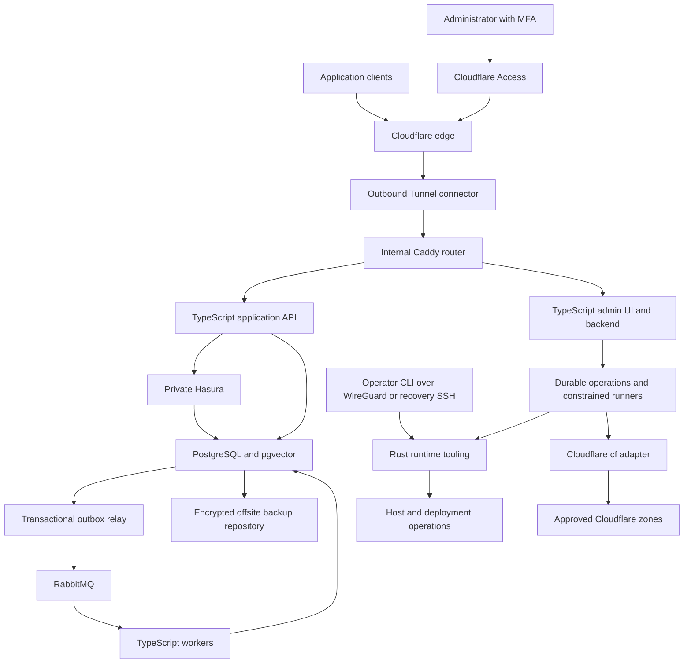

# Founder Village Runtime — Implementation Plan

> **Public-repository safety:** This repository is public. Be 100% careful never to commit,
> paste, log, or otherwise expose secrets, API keys, access tokens, passwords, private keys,
> credentials, unredacted environment values, production data, or other non-public information.
> Use placeholders and approved secret stores, inspect staged changes before every commit, and
> immediately rotate anything that may have been exposed.

Status: implemented runtime code and local verification are tracked in `IMPLEMENTATION.md`. Live provider activation and operational attestations remain separate. Authored JavaScript/MJS files are prohibited; application and automation sources use TypeScript.

## 1. Outcome and scope

Build a reproducible platform that takes a fresh VPS from provisioning through secure operation, deployment, backup, and recovery. Use `/Users/zernach/code/archlife-apps-runtime` as a reference for proven workflows, while keeping Founder Village independent of Archlife applications, secrets, domains, and production resources.

The platform must provide:

| Requirement from `PROMPT.md` | Planned implementation |
| --- | --- |
| Codified Rust to build the VPS VM runtime | A Rust CLI for provider provisioning, host convergence, configuration rendering, diagnostics, deployment, backup orchestration, and WireGuard lifecycle. |
| Deployment pipelines | Immutable release artifacts, exact revision tracking, serialized environment deployments, candidate health checks, blue/green application cutover, and rollback. |
| Backup systems | PostgreSQL point-in-time recovery, encrypted offsite backups, authenticated inventories, independent recovery credentials, and tested clean-host recovery. |
| Ultra high security | Explicit threat model, private stateful services, strong administrator authentication, tenant authorization, constrained privileged operations, independent audit archives, and executable security checks. |
| PostgreSQL with pgvector | A pinned compatible database image, versioned SQL migrations, connection budgets, tenant isolation, and scoped vector queries. |
| Hasura | Private GraphQL Engine, source-controlled metadata and permissions, separate administrative credentials, and migration ordering checks. |
| TypeScript API | Validated public API contracts, verified identities, authorization, persistence, rate limits, background work, and observability. |
| TypeScript admin panel similar to pyweb | React/TypeScript console plus a TypeScript admin backend, with environment-aware operations and durable operation status. |
| Cloudflare `cf` CLI access | A constrained server-side domain adapter that executes pinned `cf` commands with scoped credentials, previews changes, and verifies resulting DNS state. |
| Queue | Durable RabbitMQ messaging, a PostgreSQL transactional outbox, TypeScript workers, retries, dead-letter handling, and idempotency. |
| WireGuard profiles | Per-device enrollment, private profile export, narrow routes, revocation, rotation, and real connection verification. |
| What else is missing? | Identity, secret management, object storage, scheduling, monitoring, audit, capacity planning, incident response, application onboarding, and disaster recovery, detailed below. |

## 2. Reference review and reuse rules

The initial review inspected these Archlife sources:

- `README.md`, `AGENTS.md`, `docs/ARCHITECTURE.md`, `docs/SECURITY.md`, and `docs/RELEASE_WORKFLOW.md`.
- `scripts/runtime/runtime-tools/` and `scripts/runtime/interactive-runtime/` for Rust tooling and diagnostics.
- `hetzner/README.md`, `infra/README.md`, and `infra/cloudflare/README.md` for provider, firewall, Tunnel, and DNS workflows.
- `compose.yml` for private database/Hasura networking, queue persistence, and application deployment topology.
- `services/python-cloud/admin-client/src/components/dashboard/` and `services/python-cloud/docs/ADMIN_OPERATORS.md` for console capabilities and authorization boundaries.

Reuse the ideas of deterministic rendering, private service networking, diagnostics, pinned artifacts, recoverable operations, and candidate-before-cutover checks. Port only components whose behavior and dependencies are understood; review licensing before copying source. Reimplement administrative backend behavior in TypeScript rather than introducing a Python service.

Keep routine deployments fast through relevant checks and cached artifacts. Provide an explicit deeper release/security verification workflow instead of silently running every application regression during every startup or deployment. Both paths retain migration safety, authorization, candidate readiness, cutover checks, and rollback.

Reference code and historical test results are design inputs, not evidence that this new runtime is secure or deployed. When reference documentation disagrees, inspect the executable implementation before porting behavior.

## 3. Initial architecture decisions

These are planning defaults. Record final selections in architecture decision records before provisioning.

- **Provider:** Hetzner is the first VPS adapter because it matches the reference. Keep provider calls behind Rust interfaces; do not build a multi-cloud abstraction beyond those boundaries initially.
- **Host:** a supported Linux LTS release, systemd, Docker Engine, and Docker Compose. Rust provisions and configures the VM; the provider supplies virtualization. Maintain a tested Linux architecture and document local macOS container differences.
- **Source layout:** one repository containing the Rust tooling, TypeScript services, contracts, migrations, and operational definitions. Split repositories only when independent ownership or release requirements justify it.
- **Environments:** local development and disposable CI fixtures first; staging and production on separate VMs with separate credentials, networks, databases, queues, storage, and backup prefixes. Production capacity must allow two application colors alongside the stateful services.
- **Ingress:** outbound Cloudflare Tunnel to an internal Caddy router. Keep origin TCP 80/443 closed at host and provider firewalls. Expose only declared public API and authenticated admin routes. Tunnel is an ingress transport; application authorization remains mandatory. See [Cloudflare Tunnel documentation](https://developers.cloudflare.com/cloudflare-one/networks/connectors/cloudflare-tunnel/).
- **Administrative access:** WireGuard and SSH recovery access; Cloudflare Access with MFA for the browser console, plus independent backend authorization. Do not create public DNS routes to PostgreSQL, Hasura administration, RabbitMQ management, or the privileged runner.
- **Control plane:** run the admin service and operation runner independently from application blue/green stacks. Maintain SSH/CLI recovery that works when the admin UI or identity provider is unavailable. A shared VM still shares a hardware failure boundary.
- **State:** one PostgreSQL cluster per environment initially, with separate control-plane and application databases and roles. The initial application databases and matching Hasura sources are `founder-village`, `founder-farm`, `founder-cafe`, and `founder-residences`; enforce tenant isolation within each application. Use private Hasura instances and a dedicated metadata database per environment.
- **Availability:** the initial production VM is a single point of failure. Blue/green deployment improves application rollout safety; it does not provide database or host high availability. Add a replicated topology only when availability targets require it.



The diagram describes trust boundaries and main data paths, not an exhaustive network policy. Every service receives only the networks and credentials its functions require.

## 4. Proposed repository structure

```text
bin/fv                         # thin entrypoint to the Rust CLI
crates/
  fv-cli/                      # commands, structured output, orchestration
  fv-config/                   # typed config, validation, deterministic rendering
  fv-provider/                 # VPS provider API adapter
  fv-host/                     # host convergence and network policy
  fv-ops/                      # constrained operation execution and state machine
services/
  api/                         # public TypeScript API
  admin-api/                   # TypeScript admin backend
  admin-web/                   # React/TypeScript console
  workers/                     # outbox relay, jobs, schedules, integrations
packages/
  contracts/                   # runtime validation schemas, generated API types
  auth/                        # identity and authorization primitives
  observability/               # redaction, logs, metrics, trace context
  queue/                       # message envelopes and idempotency helpers
infra/
  compose/                     # data, application, and control-plane stacks
  systemd/                     # boot, backup, convergence, recovery units
  images/                      # pinned container build definitions
  templates/                   # host, Caddy, Tunnel, and WireGuard templates
config/                        # non-secret environment/application declarations
database/migrations/           # authoritative ordered SQL migrations
hasura/metadata/               # tracked models, relationships, permissions
policies/                      # allowed operations, ingress, release policies
tests/                         # integration, browser, security, recovery fixtures
docs/                          # architecture decisions, runbooks, acceptance evidence
.github/workflows/             # CI, artifact publication, controlled deployment
.state/                        # ignored generated files, receipts, local operation state
secrets/                       # ignored private material; never a Git secret store
```

Use a pinned Rust toolchain and one locked TypeScript workspace/package manager. Prefer a supported Node.js LTS, Fastify for backend services, and React/Vite for the admin web application. Verify compatibility and maintenance status during foundation work before locking versions. Avoid a second application framework or orchestrator without a concrete requirement.

## 5. Implementation workstreams

### A. Rust provisioning and host lifecycle

- Define a validated environment manifest containing provider identifiers, region, host size, network ranges, domains, resource limits, image digests, service settings, and secret references. Reject unknown fields and invalid cross-field combinations.
- Implement plan/apply/status semantics with resource ownership tags, an exclusive operation lock, redacted receipts, and durable checkpoints. Detect drift and partial failures. Repeated apply must converge without resetting credentials, data volumes, or WireGuard peers.
- Provision the VM, network, firewall, SSH access, and explicitly owned persistent storage through the provider API. Use a minimal cloud-init bootstrap to install and verify the Rust runtime artifact and establish the operator account.
- Separate initial privileged bootstrap from ordinary operator commands. Disable password/root SSH login, restrict temporary bootstrap SSH ingress, configure security updates, time synchronization, log rotation, service restart policy, and a controlled reboot window.
- Render files atomically with validated ownership and permissions. Keep secret material out of command arguments, diagnostics, plan output, generated public config, and receipts.
- Enforce provider and host firewalls, including IPv6 and Docker forwarding behavior. Private Docker networks alone are not proof that a published port is unreachable.
- Provide bounded command timeouts, cancellation, safe retry behavior, structured JSON output, and a readable interactive interface. Shell glue stays minimal; do not recreate a large shell/Python orchestration layer.
- Prohibit implicit destruction of volumes or provider resources. Destructive operations identify the exact target and require an explicit destructive command and recovery prerequisites.

### B. PostgreSQL, pgvector, and Hasura

- Pin a supported PostgreSQL/pgvector/Hasura combination and test it on local and production architectures. Include extension versions and upgrade procedures in the release manifest.
- Make ordered, checksummed SQL migrations the sole schema authority. Use a migration lock and a dedicated migration identity; API and worker credentials cannot perform DDL or act as database superusers.
- Create `vector` through a migration. Record embedding model, dimensions, version, tenant, and source provenance; plan re-embedding rather than mixing incompatible vectors. Benchmark representative indexed queries and enforce tenant filters before returning results.
- Define server-side tenant membership and ownership rules. Use PostgreSQL row-level security where applicable, with tests for role bypass and connection-pool context leakage. Hasura roles and session variables must come from verified identities, never arbitrary client headers.
- Keep Hasura administrative credentials confined to migration/control-plane operations. Normal application queries use scoped roles. Direct SQL paths must enforce the same authorization policy; document which operations belong to Hasura versus transactional SQL functions/repositories.
- Version Hasura metadata alongside migrations. Apply SQL before dependent metadata, reject inconsistencies, and test fresh bootstrap plus incremental upgrade. The distinction follows [Hasura's migration/metadata model](https://hasura.io/docs/2.0/migrations-metadata-seeds/overview/).
- Configure query/statement timeouts, connection budgets for both application colors and workers, slow-query monitoring, storage growth alerts, and maintenance. Introduce PgBouncer only with a tested session/RLS strategy and demonstrated connection need.
- Keep staging/production data separate; use synthetic or deliberately anonymized fixtures. Document logical per-application recovery separately from cluster-wide physical PITR.

### C. TypeScript API, authentication, and contracts

- Build health/liveness and dependency-aware readiness endpoints, structured errors, request IDs, bounded payloads, request deadlines, rate limits, graceful shutdown, and metrics from the first vertical slice.
- Use runtime schemas as the authority for request, response, queue, and operation contracts; generate TypeScript types and OpenAPI documentation from them. Share contracts through the workspace rather than copying generated files between services.
- Select an OIDC provider; verify issuer, audience, signature, expiry, and intended environment. Resolve user and tenant membership on the server. Administrative roles do not come from frontend state or unverified identity headers.
- Centralize authorization primitives while keeping resource ownership checks in the service that owns the data. Add cross-user, cross-tenant, cross-environment, disabled-user, and revoked-session denial cases.
- Define authentication/session revocation, account lifecycle, data retention/deletion, signed webhook replay protection, outbound HTTP limits, and SSRF restrictions before related integrations are enabled.
- Preserve actor, service identity, tenant, correlation ID, and durable job ID across asynchronous work. Redact payloads and provider diagnostics from general logs.

### D. Queue, workers, and scheduled work

- Start with RabbitMQ to reuse the reference's operating model. Pin the broker and TypeScript client; declare exchanges, queues, permissions, dead-letter routing, and retention in code.
- Use a PostgreSQL transactional outbox so business changes and the intent to enqueue commit together. A relay publishes with confirmation and marks delivery durably; consumers acknowledge only after committing their work.
- Assume at-least-once delivery. Use persistent idempotency keys, bounded exponential retries with jitter, leases/timeouts, backpressure, and dead-letter review. Require provider idempotency or reconciliation for external side effects; do not claim exactly-once delivery.
- Define job schema versions, ordering requirements, concurrency budgets, cancellation, payload limits, and stale-job handling. Store large or sensitive payloads behind scoped references.
- Use a durable scheduler with a single leased leader per environment. Define missed-run behavior and time-zone rules; restart must not duplicate scheduled effects.
- Initially the broker shares the VM failure boundary and provides no host HA. Retain sufficient outbox/job history for disaster-recovery replay; reconcile against external effects before replaying restored jobs.

### E. TypeScript admin panel and safe operations

Build a useful replacement for the reference pyweb workflows, in this order:

1. Service health, deployed revisions, environment selection, sanitized logs, alerts, and resource utilization.
2. Deployment history, candidate status, rollback, migration status, backup freshness, and restore-drill results.
3. Queue depth, job status, controlled retries, dead letters, and scheduled tasks.
4. Administrator accounts, application/environment-scoped grants, audit history, and access revocation.
5. Domain/DNS management, certificate/Tunnel status, and WireGuard peer inventory and revocation.
6. Guarded recovery actions and application onboarding after the underlying CLI procedures are proven.

Use named administrators with MFA, short sessions, server-side RBAC, same-origin/CSRF protection, secure cookies, restrictive browser headers, accessible controls, and explicit environment indicators. Verify Cloudflare Access assertions at the backend trust boundary; an Access login alone does not authorize an operation.

Represent every mutation as a typed operation: requester, scope, validated parameters, desired-state hash, idempotency key, status, timestamps, and safe outcome. Show queued/running/succeeded/failed/cancelled states and recover them after browser or service restarts. Preview production-impacting changes and re-check authorization and drift when execution begins.

The admin web/backend must not hold a Docker socket, root shell, provider-wide key, or unrestricted command execution endpoint. Separate low-privilege Cloudflare operations from host operations. A private Rust runner executes a fixed operation catalog with scoped service authentication and verified human attribution. Its host authority is a critical trust boundary, even if the API surface is small.

Raw SQL consoles, arbitrary shell terminals, automatic fleet-wide notification tools, and application-specific Archlife panels are outside the initial console scope. Add such capabilities only through separate requirements and permission design.

### F. Cloudflare domain automation using `cf`

Cloudflare currently documents `cf` resource management and DNS operations, including JSON output and dry-run request previews. Pin the tested CLI release because this interface is evolving. See [the official resource-management guide](https://developers.cloudflare.com/cf/get-started/resources/).

- Run `cf` in a dedicated server-side adapter/worker. Use a fixed executable, fixed operation schemas, argument arrays, bounded JSON input/output, timeouts, and redacted errors. Never concatenate browser input into a shell command.
- Start with zone discovery, complete paginated DNS inventory, create/update managed records, explicit deletion, and verification. Domain registration, purchasing, transfer, and registrar changes are a separate future scope.
- Restrict operations to configured account/zone IDs and owned record names. Distinguish managed records from unrelated DNS; import approved existing records before reconciling them. Preserve mail, DNSSEC, verification, and unrelated application records.
- Produce a before/after plan tied to current record IDs and content. `cf --dry-run` previews a request; the runtime must independently compute the live-state diff and detect conflicts. Verify authoritative DNS, proxied behavior where applicable, TLS, and intended routes after a change.
- Use separate scoped read/write tokens and separate Tunnel/Access credentials where needed. Never use the Global API key. Grant only necessary resource permissions, following [Cloudflare token guidance](https://developers.cloudflare.com/fundamentals/api/get-started/create-token/).
- Use one writer for managed resources across CLI, admin UI, and CI. All call the same operation implementation and ownership registry; do not add a competing Terraform reconciliation loop for those resources.
- Verify final state after deletion as well as creation. The documented CLI can exit successfully when a noninteractive deletion was skipped; exit code alone is insufficient. Test the pinned release's confirmation behavior explicitly.

### G. WireGuard and recovery access

- Assign each operator device its own peer identity, unique address, route scope, expiry/review date, and revocation record. Avoid shared profiles.
- Prefer generating the client private key on the client and enrolling only its public key. If the runtime exports a full profile, write it once to an ignored private file with mode `0600`; never put it in logs, audit payloads, browser history, or ordinary artifacts.
- Default to split-tunnel management access; full internet egress is a separate feature. Check subnet collisions and IPv4/IPv6 routing before activation. Do not switch the operator workstation's default route automatically.
- Reconcile peers without disrupting unrelated connections. Rotation and revocation must update running state and persistent configuration, with public-key inventory checks and real handshake/private-service access verification.
- Keep normal SSH private. Document a tightly scoped, expiring provider-firewall recovery path and provider-console procedure for a broken VPN. Test recovery without relying on the admin UI, production DNS, or the VM's own secret service.

### H. Security, secrets, and audit

Turn “ultra high security” into controls with evidence rather than an absolute security claim:

- Write a threat model covering public API compromise, tenant escape, malicious administrators, queue abuse, CI compromise, leaked credentials, host takeover, backup deletion, and Cloudflare/identity-provider outages.
- Use separate environment/service credentials, private mount permissions, rotation procedures, and expiry alerts. Choose an encrypted configuration workflow such as SOPS/age, with an external recovery key and narrowly materialized host secrets. Do not make recovery depend on a vault running only on the failed VM.
- Separate online keys required for service operation from independently escrowed recovery keys and offline trust roots. Encryption at rest must include data volumes, backup repositories, and key-custody/boot tradeoffs; verify actual provider guarantees instead of assuming disk encryption.
- Harden containers with non-root users where supported, minimal capabilities, read-only filesystems where practical, resource limits, network separation, and no unnecessary host mounts. Document justified exceptions for databases and host agents.
- Keep an append-only administrative/security ledger recording successful, denied, failed, and cancelled operations, verified actors, resource scope, and safe outcomes. Protect it from application-role edits and independently archive integrity checkpoints. Same-database hash chains do not protect against a database superuser.
- Record sensitive data changes only where required, with encrypted restricted versions and a documented retention policy. General logs must exclude tokens, cookies, personal data, SQL parameters, request bodies, and secret-bearing URLs. Use synthetic canaries to test leakage.
- Pin images by digest, lock dependencies and tooling, generate SBOMs, scan secrets/dependencies/images, verify artifact signatures, restrict CI credentials, and document vulnerability triage with accountable expiry for any accepted exception.
- Establish incident, credential-revocation, host-compromise, and data-exposure runbooks. Apply security engineering from the start; legal/compliance applicability and provider agreements require their own assessment before regulated data is introduced.

### I. Backup, restore, and disaster recovery

Initial recovery objectives are design targets to validate against measured data volume and network throughput: PostgreSQL **RPO ≤ 5 minutes**, complete-runtime **RTO ≤ 4 hours**, and object/config backup **RPO ≤ 24 hours**. Document the resulting cross-system consistency window; tighten it if the application cannot tolerate it.

- Use pgBackRest physical backups plus continuous WAL archiving for PostgreSQL PITR. Begin with weekly full and daily differential backups and a 30-day recovery window; retain every dependency needed for that window. Tune cadence after measuring restore time, cost, and WAL growth. See [pgBackRest backup and PITR guidance](https://pgbackrest.org/user-guide.html).
- Send encrypted backups off the VPS into a separate account/failure domain. Maintain an independently protected immutable or offline copy; an ordinary application/host credential must not be able to erase all recovery history. Verify retention-lock and deletion behavior on the selected storage provider.
- Separate backup ingestion, retention maintenance, and recovery credentials. Prove tool compatibility with those permissions rather than assuming a no-delete token supports every backup operation. Keep recovery keys and instructions accessible independently of the runtime.
- Include cluster roles/grants, extensions, control-plane databases, Hasura metadata, release manifests, declarative infrastructure/configuration, encrypted secrets, WireGuard server recovery material, queue definitions, and object-storage inventories. Classify each artifact as rebuildable, restorable, or externally recoverable.
- Use authenticated manifests covering the exact artifact set, size/checksum validation, completion markers, and freshness derived from authenticated metadata. Parse metadata as data; validate archive paths/types/links and decryption before touching current secrets or data.
- Monitor WAL archive lag, backup freshness, failed jobs, offsite-copy completion, and repository storage. A local backup success does not prove an offsite copy or successful restore.
- Run automated isolated database restore checks and a monthly clean-VM recovery drill, plus drills after material backup/schema changes. Keep restored applications, schedulers, mail, and external side effects disabled until reconciliation and validation complete.
- Reconcile user/session revocation, deleted accounts, job idempotency, external payment/email effects, object references, and audit checkpoints before reopening a restored environment. A physical PITR rewinds the cluster, not external providers or independently retained audit history.
- Preserve current data and remote recovery copies on failed transfers or failed verification. Cleanup follows verified retention policy and does not delete the only usable backup to make disk space.

### J. Deployment and supply-chain pipeline

1. **Pull request:** formatting, Rust static checks, TypeScript type checks, focused behavior tests, config validation, migration/Hasura checks, secret scanning, and relevant dependency/security checks.
2. **Build:** produce minimal immutable images and Rust binaries once; record source SHA, dependency locks, image digests, migration/metadata versions, SBOMs, and signatures in a release manifest.
3. **Staging:** deploy that manifest, run authenticated API/worker/admin smoke tests, verify tenant denials and intended network exposure, and record real candidate receipts.
4. **Production preparation:** select the same artifacts, check resources/backup freshness/migration compatibility, acquire an environment lease, and prepare the inactive application color. Resolve exact artifacts before execution; never deploy a moving `main` checkout.
5. **Migration and candidate checks:** run compatible additive migrations under a lock, apply Hasura metadata safely, and check readiness, protected routes, persistence, worker compatibility, and observability. Use expand/contract changes across releases.
6. **Cutover:** atomically switch validated proxy configuration, drain old requests/connections, and verify external HTTPS behavior and the serving digest. Workers need a separate leased handover so old/new consumers and schedulers do not duplicate effects.
7. **Postcheck/rollback:** retain the previous application artifact and safe route configuration. Roll back application traffic on failed postchecks; database rollback requires an explicit compatibility/recovery decision. Never automatically run destructive down migrations or restore production to undo a routine rollout.

Serialize mutations per environment, revalidate leases on resume, and keep partial operations retryable. Prefer short-lived CI identity where supported; otherwise use narrowly scoped deploy credentials. Avoid an internet-facing “run deploy command” webhook in the public API. A private runner may pull verified release artifacts and execute the fixed deployment operation.

Offer a separate explicit full-release workflow for expanded browser/security/load/recovery checks. Receipt reuse must match exact artifact/config/policy fingerprints and freshness rules. Report build, publication, staging validation, production cutover, and postchecks as separate states.

### K. Missing operational essentials

| Capability | Initial treatment |
| --- | --- |
| Object/file storage | Private S3-compatible storage outside the application VM where practical; scoped signed URLs, upload size/type constraints, retention/versioning, backup, and orphan cleanup. Select a provider with measured recovery behavior. |
| Monitoring and alerting | Structured redacted logs, OpenTelemetry-compatible traces, host/service metrics, backup/queue/certificate alerts, an external uptime probe, and an alert destination independent of the VM. |
| Capacity and cost | Budgets for database connections, RAM/CPU, disk/inodes, WAL, image/cache growth, queue depth, network egress, backups, and provider spend. Guard cleanup so serving/rollback images and data survive. |
| Service email | Provider adapter and durable delivery status when account/invitation/incident workflows need mail; bounded retries and non-production suppression. Test with a sink before real delivery. |
| Application onboarding | Registry of namespace, owner, environment, domains, roles, migrations, Hasura configuration, queues, storage, secrets, health checks, backup inclusion, and retirement policy. |
| Local development | One documented startup path, hot reload, synthetic seed data, isolated ports/namespaces, local TLS, and no accidental production credentials or background sends. |
| Maintenance | Database/extension/broker upgrades, OS patches/reboots, certificate renewal, key rotation, restore verification, dependency updates, and on-call ownership. |
| Data lifecycle | Classification, consent where relevant, export/deletion, retention, audit minimization, and delayed deletion of expired backup copies under the approved policy. |
| Reliability objectives | Initial SLOs, error budgets, RPO/RTO, escalation contacts, incident severity, recovery dependencies, and honest single-host limitations. |

Do not initially add Kubernetes, a service mesh, Elasticsearch, a separate vector database, a self-hosted password manager, or a second queue/cache layer without a demonstrated need. Revisit database replication, broker clustering, and multiple application hosts when required by measured load or availability objectives.

## 6. Delivery sequence and acceptance gates

Each phase ends with reviewable code, documentation, and evidence tied to its revision. Keep infrastructure mutations out of the planning phase.

| Phase | Deliverables | Required exit evidence |
| --- | --- | --- |
| 0 — Decisions and threat model | Confirm environment/domain/provider choices, data classification, budget, initial SLOs, OIDC, secret custody, backup provider, supported version matrix, and architecture decisions. | Resource/credential inventory, trust-boundary diagram, recovery design, and explicit unresolved external prerequisites. No invented account IDs or domains. |
| 1 — Repository and local slice | Rust and TypeScript workspaces, locked tools, private Compose stack, migrations, pgvector, Hasura metadata, minimal API/worker, and admin shell. | A clean checkout starts with synthetic data; bootstrap repeats safely; an authenticated tenant creates/reads a record and vector search result; another tenant is denied. |
| 2 — VPS and management access | Rust provider adapter, host convergence, firewall, systemd, secret delivery, WireGuard, ingress, and CLI diagnostics. | A disposable VM is provisioned and converged twice without data/peer loss; actual external port checks cover IPv4/IPv6; a real management peer connects; recovery access is demonstrated. |
| 3 — Recovery and observability | Encrypted offsite backups, WAL archiving, manifests, storage inventory, external monitoring, alert routing, and recovery runbooks. | Restore to an isolated fresh target, verify application data/vector/permissions, measure RPO/RTO, validate offsite integrity, and demonstrate a missing-backup alert. |
| 4 — Release pipeline | CI checks, immutable signed artifacts, staging promotion, deployment leases, blue/green routing, worker handover, and rollback. | Successful staging rollout and a deliberately failing candidate; old traffic remains healthy; a simulated postcheck failure restores the previous route; serving digests match the release manifest. |
| 5 — Admin and domain operations | Useful TypeScript console, scoped admin accounts, durable operations, runner separation, pinned `cf` adapter, and WireGuard management. | Authenticated browser operation survives refresh/restart; unauthorized/spoofed/CSRF requests fail; canary DNS create/update/delete is verified; unrelated records and peers remain intact. |
| 6 — Hardening and production readiness | Threat-driven security review, dependency/image checks, capacity/load baseline, incident exercises, and documentation closure. | Tenant-escape, injection, SSRF, token-replay, queue-retry, backup-tamper, and runner-boundary scenarios pass; outage/restore drills and remaining risks have accountable owners. |
| 7 — Controlled first launch | Provision the separately approved production environment, promote the verified release, initialize backups/alerts, and perform real acceptance checks. | Independent external HTTPS, authenticated persistence, queue processing, admin denial, WireGuard, deployed artifact, backup-copy, and restore evidence. Record any provider/device layers still unverified. |

Work within a phase can overlap where safe, but production launch depends on recovery, deployment, and security gates. Admin write actions follow proven CLI procedures rather than becoming the first implementation of dangerous operations.

## 7. First implementation milestone

Implement one complete synthetic workflow before expanding the console:

1. Initialize local configuration and secrets through the Rust CLI.
2. Start private PostgreSQL/pgvector, Hasura, RabbitMQ, API, worker, and the admin shell.
3. Authenticate a synthetic tenant, write a record and outbox entry in one transaction, process the job, and read the persisted result through an authorized API route.
4. Deny another tenant, spoofed Hasura identity, and an unauthorized administrator.
5. Inspect safe health/job/audit information from the TypeScript console.
6. Restart the worker during delivery and prove idempotent recovery.
7. Back up the resulting data, restore into an isolated target, and repeat the authorized read and denial checks.

Then move the same artifact/configuration model to a disposable VPS and add real ingress, WireGuard, and a Cloudflare canary. This establishes the full data, identity, operation, and recovery path before accumulating infrastructure features.

## 8. Definition of done and outstanding decisions

The runtime is ready for its first production use when a clean machine can provision it from versioned inputs, the first application works end to end, administrators can operate it without unrestricted browser-to-host authority, releases can fail safely, and an independent recovery drill meets the chosen targets. Evidence must distinguish local fixtures, hosted CI, provider configuration, authenticated deployed behavior, offsite backup integrity, and actual restore success.

Before creating billable resources or production credentials, finalize:

- VPS account, region, architecture, sizing, monthly budget, and data residency.
- Owned Cloudflare account/zones, canonical hostnames, managed-record ownership, and required plan features.
- OIDC provider, initial administrators, MFA, and independent break-glass custodians.
- Backup/object-storage providers, retention requirements, immutable-copy mechanism, key custody, and acceptable cross-system recovery window.
- Application/tenant model, sensitive-data classification, compliance obligations if any, and initial traffic/availability objectives.

These choices do not block repository scaffolding or synthetic local verification. Implementation now lives in this repository. Live provisioning, credential creation, Git publication, and production deployment are separate operations; see the implementation evidence and runbooks.
